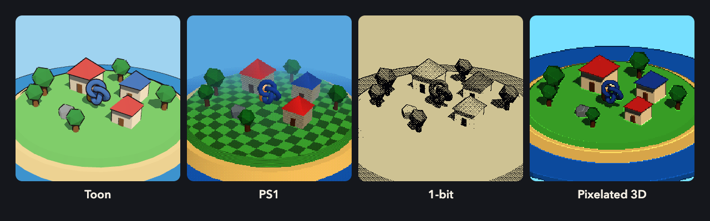

# Awesome Game Art Styles 

  

**English** · [简体中文](README.zh-CN.md)

> 52 game visual styles, organised by **look**. Click a style for screenshots, how to recognise it, techniques, tutorials, free assets and notes for coding agents.

Screenshots are loaded from Steam and link to each game's store page; nothing is rehosted here. Use the [Claude Code skill](skills/game-art-style/SKILL.md) to get a style recommendation for your own game, or try the [live shader demos](https://homkathon.github.io/awesome-game-art-styles/demos/) for toon, PS1, 1-bit and pixelated 3D.

## Contents

- [3D: shading & form](#3d-shading--form)
- [3D: retro & lo-fi](#3d-retro--lo-fi)
- [3D: handmade & material](#3d-handmade--material)
- [Light & silhouette](#light--silhouette)
- [2D: pixel](#2d-pixel)
- [2D: drawn & painted](#2d-drawn--painted)
- [2D: graphic & print](#2d-graphic--print)
- [Asset libraries](#asset-libraries)
- [Learning resources](#learning-resources)
- [Related lists](#related-lists)
- [Wanted](#wanted)

## 3D: shading & form

<table>
<tr>
<td align="center" valign="top" width="25%"> <a href="styles/low-poly/"><b>Low-poly</b></a> 低多边形</td>
<td align="center" valign="top" width="25%"> <a href="styles/toy-diorama/"><b>Toy diorama / tilt-shift</b></a> 玩具微缩景</td>
<td align="center" valign="top" width="25%"> <a href="styles/minimal-geometric/"><b>Minimal geometric 3D</b></a> 极简几何 3D</td>
<td align="center" valign="top" width="25%"> <a href="styles/toon/"><b>Cel-shaded / toon</b></a> 卡通渲染</td>
</tr>
<tr>
<td align="center" valign="top" width="25%"> <a href="styles/anime-cel/"><b>Anime cel 2.5D</b></a> 日式赛璐璐 2.5D</td>
<td align="center" valign="top" width="25%"> <a href="styles/ligne-claire/"><b>Ligne claire / Moebius</b></a> 清线 / 墨比斯</td>
<td align="center" valign="top" width="25%"> <a href="styles/painterly/"><b>Painterly</b></a> 油画感</td>
<td align="center" valign="top" width="25%"> <a href="styles/flat-colour-3d/"><b>Flat-colour graphic 3D</b></a> 平涂图形化 3D</td>
</tr>
<tr>
<td align="center" valign="top" width="25%"> <a href="styles/retro-futurism/"><b>Retro-futurism</b></a> 复古未来主义</td>
<td align="center" valign="top" width="25%"> <a href="styles/mixed-media/"><b>Mixed media</b></a> 混合媒介</td>
<td align="center" valign="top" width="25%"> <a href="styles/fmv/"><b>FMV / live action</b></a> 真人影像 / FMV</td>
<td align="center" valign="top" width="25%"> <a href="styles/graffiti/"><b>Graffiti / Y2K street</b></a> 涂鸦 / Y2K 街头</td>
</tr>
<tr>
<td align="center" valign="top" width="25%"> <a href="styles/soft-pastel/"><b>Soft pastel / jelly</b></a> 软萌糖果色</td>
</tr>
</table>

## 3D: retro & lo-fi

<table>
<tr>
<td align="center" valign="top" width="25%"> <a href="styles/ps1/"><b>PS1 / low-fi 3D</b></a> PS1 复古 3D</td>
<td align="center" valign="top" width="25%"> <a href="styles/pixelated-3d/"><b>Pixelated 3D</b></a> 像素化 3D</td>
<td align="center" valign="top" width="25%"> <a href="styles/voxel/"><b>Voxel</b></a> 体素</td>
<td align="center" valign="top" width="25%"> <a href="styles/1-bit/"><b>1-bit / dithered</b></a> 1-bit 抖动</td>
</tr>
<tr>
<td align="center" valign="top" width="25%"> <a href="styles/pre-rendered/"><b>Pre-rendered backgrounds</b></a> 预渲染背景</td>
<td align="center" valign="top" width="25%"> <a href="styles/boomer-shooter/"><b>Retro FPS / boomer shooter</b></a> 复古 FPS</td>
<td align="center" valign="top" width="25%"> <a href="styles/lo-fi-surreal/"><b>Lo-fi surreal / ugly</b></a> 低保真超现实 / 丑美学</td>
</tr>
</table>

## 3D: handmade & material

<table>
<tr>
<td align="center" valign="top" width="25%"> <a href="styles/claymation/"><b>Claymation</b></a> 黏土定格</td>
<td align="center" valign="top" width="25%"> <a href="styles/papercraft/"><b>Papercraft</b></a> 纸艺</td>
<td align="center" valign="top" width="25%"> <a href="styles/yarn/"><b>Yarn / fabric</b></a> 毛线 / 织物</td>
<td align="center" valign="top" width="25%"> <a href="styles/dark-miniature/"><b>Dark miniature</b></a> 黑暗微缩</td>
</tr>
</table>

## Light & silhouette

<table>
<tr>
<td align="center" valign="top" width="25%"> <a href="styles/silhouette/"><b>Silhouette noir</b></a> 剪影黑白</td>
<td align="center" valign="top" width="25%"> <a href="styles/neon-abstract/"><b>Neon abstract</b></a> 霓虹抽象</td>
<td align="center" valign="top" width="25%"> <a href="styles/vector-wireframe/"><b>Vector / wireframe</b></a> 矢量线框</td>
<td align="center" valign="top" width="25%"> <a href="styles/spot-colour/"><b>Monochrome + one colour</b></a> 单色 + 强调色</td>
</tr>
<tr>
<td align="center" valign="top" width="25%"> <a href="styles/liminal/"><b>Liminal spaces</b></a> 阈限空间</td>
</tr>
</table>

## 2D: pixel

<table>
<tr>
<td align="center" valign="top" width="25%"> <a href="styles/pixel-art/"><b>Pixel art</b></a> 像素画</td>
<td align="center" valign="top" width="25%"> <a href="styles/hd-2d/"><b>HD-2D</b></a> HD-2D</td>
<td align="center" valign="top" width="25%"> <a href="styles/pixel-anime/"><b>Pixel anime / cyberpunk</b></a> 像素动漫 / 赛博朋克</td>
<td align="center" valign="top" width="25%"> <a href="styles/neon-80s/"><b>Neon 80s pixel</b></a> 80 年代霓虹像素</td>
</tr>
<tr>
<td align="center" valign="top" width="25%"> <a href="styles/cozy/"><b>Cozy interiors</b></a> 温馨室内像素</td>
<td align="center" valign="top" width="25%"> <a href="styles/nes-8bit/"><b>8-bit / NES</b></a> 8-bit / FC</td>
</tr>
</table>

## 2D: drawn & painted

<table>
<tr>
<td align="center" valign="top" width="25%"> <a href="styles/hand-drawn/"><b>Hand-drawn animation</b></a> 手绘动画</td>
<td align="center" valign="top" width="25%"> <a href="styles/rubber-hose/"><b>Rubber hose (1930s cartoon)</b></a> 橡皮管 30 年代卡通</td>
<td align="center" valign="top" width="25%"> <a href="styles/watercolour/"><b>Watercolour</b></a> 水彩</td>
<td align="center" valign="top" width="25%"> <a href="styles/ink-wash/"><b>Ink wash / sumi-e</b></a> 水墨</td>
</tr>
<tr>
<td align="center" valign="top" width="25%"> <a href="styles/gothic-ink/"><b>Gothic ink</b></a> 哥特墨线</td>
<td align="center" valign="top" width="25%"> <a href="styles/painted-comic/"><b>Painted comic</b></a> 彩绘漫画</td>
<td align="center" valign="top" width="25%"> <a href="styles/line-art/"><b>Line art / colouring book</b></a> 线稿 / 涂色书</td>
<td align="center" valign="top" width="25%"> <a href="styles/cute-dark/"><b>Cute but dark</b></a> 可爱黑暗</td>
</tr>
<tr>
<td align="center" valign="top" width="25%"> <a href="styles/storybook/"><b>Storybook / picture book</b></a> 绘本</td>
<td align="center" valign="top" width="25%"> <a href="styles/rotoscope/"><b>Rotoscope / flat polygons</b></a> 转描 / 平面多边形</td>
</tr>
</table>

## 2D: graphic & print

<table>
<tr>
<td align="center" valign="top" width="25%"> <a href="styles/flat-vector/"><b>Flat vector minimal</b></a> 扁平极简矢量</td>
<td align="center" valign="top" width="25%"> <a href="styles/graphic-design/"><b>Graphic design / Saul Bass</b></a> 平面设计</td>
<td align="center" valign="top" width="25%"> <a href="styles/bureaucratic/"><b>Bureaucratic / propaganda</b></a> 官僚 / 宣传画</td>
<td align="center" valign="top" width="25%"> <a href="styles/manuscript/"><b>Medieval manuscript / woodcut</b></a> 中世纪手抄本 / 木刻</td>
</tr>
<tr>
<td align="center" valign="top" width="25%"> <a href="styles/ascii/"><b>ASCII / text</b></a> ASCII / 字符画</td>
<td align="center" valign="top" width="25%"> <a href="styles/desktop-ui/"><b>Desktop / OS interface</b></a> 桌面 / 操作系统界面</td>
<td align="center" valign="top" width="25%"> <a href="styles/stained-glass/"><b>Stained glass</b></a> 彩色玻璃</td>
</tr>
</table>

## Asset libraries

Free or cheap packs that work across several styles. Licences were checked on 2026-10-28; check again before you ship.

| Library | Type | Licence | Cost | Notes |
|:--|:--|:--|:--|:--|
| [KayKit Furniture Bits](https://kaylousberg.itch.io/furniture-bits) | 3D | 🟢 CC0 | Free | 50+ pieces on one gradient atlas: recolour the whole set by editing one image. The author asks that unmodified copies not be resold; the pack is still CC0. [GitHub](https://github.com/KayKit-Game-Assets/KayKit-Furniture-Bits-1.0) has it as a Godot addon, with the other [KayKit packs](https://github.com/KayKit-Game-Assets). |
| [Kenney](https://kenney.nl/assets) | 3D / 2D | 🟢 CC0 | Free | Huge library, including animated [Mini Characters](https://kenney.nl/assets/mini-characters) and the [Furniture Kit](https://kenney.nl/assets/furniture-kit). |
| [Quaternius](https://quaternius.itch.io) | 3D | 🟠 Custom | Free | Pack pages say CC0, but the site now publishes its own Quaternius Asset Licence. |
| [Poly Pizza](https://poly.pizza) | 3D | 🟡 CC0 / CC-BY | Free | 7000+ lowpoly models; check each one. |
| [Synty POLYGON](https://syntystore.com/products/polygon-office-pack) | 3D | 🔴 Commercial | Paid | Large themed packs; the licence does not address web builds. |
| [LimeZu Modern Interiors](https://limezu.itch.io/moderninteriors) | Pixel | 🔴 Commercial | Paid | Credit required. Cosy pixel interiors. |
| [2dPig Pixel Office](https://2dpig.itch.io/pixel-office) | Pixel | 🟢 CC0 | Free | Office props and five characters. |
| [Open Peeps](https://www.openpeeps.com) | 2D | 🟢 CC0 | Free | Hand-drawn mix-and-match people. |
| [Humaaans](https://www.humaaans.com) | 2D | 🟠 Unclear | Free | Licence wording varies between sources. |
| [ambientCG](https://ambientcg.com) | Texture | 🟢 CC0 | Free | Paper, fabric, wood. [Official licence](https://docs.ambientcg.com/license/) confirms commercial use without attribution. |
| [Poly Haven](https://polyhaven.com) | Texture / HDRI | 🟢 CC0 | Free | HDRIs, textures, models. |

## Learning resources

| Resource | Format | Covers |
|:--|:--|:--|
| [Godot Shaders](https://godotshaders.com) | Shader library | Toon, outlines, PSX, dithering, watercolour and more. |
| [Toon shader tutorial](https://roystan.net/articles/toon-shader/) | Article | Step-by-step cel shading (Roystan). |
| [5 ways to draw an outline](https://ameye.dev/notes/rendering-outlines/) | Article | Comparison of outline techniques (Alexander Ameye). |
| [GuiltyGearXrd's Art Style](https://www.youtube.com/watch?v=yhGjCzxJV3E) | GDC talk | Making 3D look hand-drawn. |
| [Obra Dinn devlog: dithering](https://forums.tigsource.com/index.php?topic=40832.msg1363742#msg1363742) | Devlog | Stable 1-bit dithering (Lucas Pope). |
| [Acerola](https://www.youtube.com/@Acerola_t) | Video channel | Stylised rendering deep dives. |
| [t3ssel8r](https://www.youtube.com/@t3ssel8r) | Video channel | Pixel-art look in real-time 3D. |
| [Lospec palette list](https://lospec.com/palette-list) | Palette library | Palettes for pixel art and limited-colour styles. |

## Popular X posts (curated)

22 verified creator-authored posts grouped by technique. Selected for actionable rendering, shader and art workflow ideas rather than raw engagement numbers. **Curated, not a live popularity ranking**: X does not expose comparable engagement counts for every post. Original post author, text and date checked against X embed metadata on 2026-10-28.

### Water & atmosphere

| Post | Creator · date | Technique | Relevant style |
|:--|:--|:--|:--|
| [Shoreline shader redux](https://x.com/Cyanilux/status/1864638156588400707) | Cyanilux · 2024-12-05 | Coastal wave and wet-sand treatment; follow-up tutorial linked from the post | [Cozy interiors](styles/cozy/) |
| [Shoreline shader mini-breakdown](https://x.com/Cyanilux/status/1252298028607774721) | Cyanilux · 2020-04-20 | Depth-aware shoreline foam and water edges inspired by Animal Crossing | [Cozy interiors](styles/cozy/) |
| [Gerstner-wave ocean](https://x.com/Cyanilux/status/1581210772352290818) | Cyanilux · 2022-10-15 | Stylized ocean wave displacement using Gerstner waves | [Flat-colour graphic 3D](styles/flat-colour-3d/) |
| [2.5D water with sprite reflections](https://x.com/Cyanilux/status/1770095395848237506) | Cyanilux · 2024-03-19 | Top-down water shader with reflected pixel-art sprites | [HD-2D](styles/hd-2d/) |
| [Procedural aurora](https://x.com/Cyanilux/status/1495405379253116930) | Cyanilux · 2022-02-20 | Displaced subdivided quads, gradients, scrolling noise and distance fade | [Neon abstract](styles/neon-abstract/) |

### Lighting & stylized rendering

| Post | Creator · date | Technique | Relevant style |
|:--|:--|:--|:--|
| [Analytical ambient occlusion](https://x.com/florisium/status/1975506073319567393) | florisium · 2025-10-07 | Primitive-based analytical AO technique and scene comparison (technical thread) | [Toy diorama / tilt-shift](styles/toy-diorama/) |
| [Billboarded light shafts](https://x.com/Cyanilux/status/1783442615939297380) | Cyanilux · 2024-04-25 | Light-aligned billboard quads, shadow masking and depth fading | [Silhouette noir](styles/silhouette/) |
| [Dungeons of Hinterberg: outlines](https://x.com/PhilippSeifried/status/1362466015976783872) | PhilippSeifried · 2021-02-18 | Technical thread on outlines with controllable width and placement | [Ligne claire / Moebius](styles/ligne-claire/) |
| [Dungeons of Hinterberg: stylized rendering](https://x.com/PhilippSeifried/status/1354827696707002384) | PhilippSeifried · 2021-01-28 | Custom deferred rendering with material IDs stored in a G-buffer | [Cel-shaded / toon](styles/toon/) |

### Materials & procedural worlds

| Post | Creator · date | Technique | Relevant style |
|:--|:--|:--|:--|
| [Stained glass and volumetric rays](https://x.com/Cyanilux/status/1407727586986311687) | Cyanilux · 2021-06-23 | Glass-pane shading combined with ray-marched shafts of light | [Stained glass](styles/stained-glass/) |
| [Holographic foil shader](https://x.com/Cyanilux/status/1376949139838275584) | Cyanilux · 2021-03-30 | Rainbow texture with view-direction-based tangent-space UV parallax | [Retro-futurism](styles/retro-futurism/) |
| [GPU-instanced grass with Shader Graph](https://x.com/Cyanilux/status/1396848736022802435) | Cyanilux · 2021-05-24 | Graphics.DrawMeshInstancedIndirect with Unity Shader Graph | [Low-poly](styles/low-poly/) |
| [Procedural ivy on curves](https://x.com/Cyanilux/status/1618030887412862977) | Cyanilux · 2023-01-24 | Blender Geometry Nodes distributing ivy leaves along hand-drawn curves | [Low-poly](styles/low-poly/) |
| [World-bending Shader Graph subgraph](https://x.com/Cyanilux/status/1251916279205814272) | Cyanilux · 2020-04-19 | Shader Graph deformation with C# toggles between editor and game | [Toy diorama / tilt-shift](styles/toy-diorama/) |

### VFX & destruction

| Post | Creator · date | Technique | Relevant style |
|:--|:--|:--|:--|
| [Fake volumetric smoke](https://x.com/Tuatara_Games/status/2019471084375130140) | Tuatara_Games · 2026-02-05 | Camera-facing deformed mesh, unlit shading and directional normal-map lighting | [Silhouette noir](styles/silhouette/) |
| [Tornado made from noise layers](https://x.com/Cyanilux/status/1483094258076856320) | Cyanilux · 2022-01-17 | Alpha-clipped scrolling noise layers, vertex displacement and particles | [Silhouette noir](styles/silhouette/) |
| [Render-texture-driven fracture](https://x.com/Cyanilux/status/1638623920235356172) | Cyanilux · 2023-03-22 | Graphics.Blit writes raycast hits to a mask driving a fractured surface | [Retro FPS / boomer shooter](styles/boomer-shooter/) |
| [Tentacle via vertex displacement](https://x.com/Cyanilux/status/1524697139812573185) | Cyanilux · 2022-05-12 | Vertex displacement for a procedurally animated tentacle | [Lo-fi surreal / ugly](styles/lo-fi-surreal/) |
| [Magic sword slash VFX](https://x.com/Cyanilux/status/1467533351091376136) | Cyanilux · 2021-12-05 | Shader-driven weapon-slash effect (companion Shader Graph breakdown) | [Anime cel 2.5D](styles/anime-cel/) |

### Pixel art & 2D

| Post | Creator · date | Technique | Relevant style |
|:--|:--|:--|:--|
| [Pixel-art waterfall breakdown](https://x.com/lunoland/status/1068933280005844992) | lunoland · 2018-12-01 | Layered sprites, shaders and 13 particle systems for a pixel waterfall | [Pixel art](styles/pixel-art/) |
| [Dithered and pixelated lighting](https://x.com/Cyanilux/status/1595484469699526665) | Cyanilux · 2022-11-23 | Experimental lighting quantized into pixel and dither patterns | [Pixelated 3D](styles/pixelated-3d/) |
| [Palette-driven pixel-art lighting](https://x.com/MadeInHevinis/status/1847072515572507001) | MadeInHevinis · 2024-10-18 | Lighting colors chosen directly from a sprite shading palette | [Pixel art](styles/pixel-art/) |

## Related lists

- [awesome-cc0](https://github.com/madjin/awesome-cc0) - Public-domain assets.
- [awesome-gamedev](https://github.com/Calinou/awesome-gamedev) - Free software and free culture for making games.
- [Awesome-Gamedev](https://github.com/FronkonGames/Awesome-Gamedev) - Broad game development resource list.
- [Awesome-Illustrations-4Projects](https://github.com/Anmol-Baranwal/Awesome-Illustrations-4Projects) - Illustration libraries.
- [awesome-pixel-art](https://github.com/Siilwyn/awesome-pixel-art) - Pixel art tutorials and tools.
- [awesome-godot](https://github.com/Calinou/awesome-godot) - Godot plugins, templates and demos.

## Wanted

Styles without a good reference game in the list yet. Pull requests welcome.

| Style | What to look for |
|:--|:--|
| Risograph / two-ink print | Halftone dots, two spot inks, mis-registration |
| Corporate Memphis | Flat blob people, noodle limbs, tech-brand pastels |
| Blueprint / technical drawing | Line drawings on a grid, dimensions, annotations |
| Ukiyo-e woodblock | Woodblock outlines, flat bokashi gradients |
| Manga screentone | Screentone patterns, speed lines, panel layouts |
| Gouache picture book | Opaque painted shapes, visible brush texture |

## Contributing

See [CONTRIBUTING.md](CONTRIBUTING.md).

---

If this list helped you pick a look, a ⭐ helps other developers find it.
