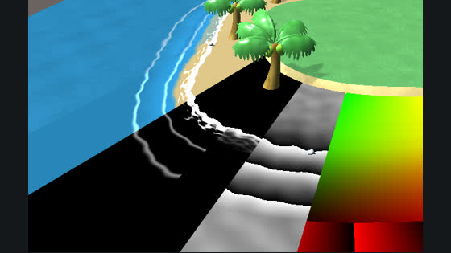
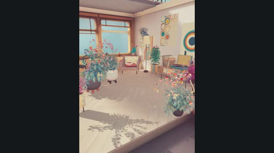
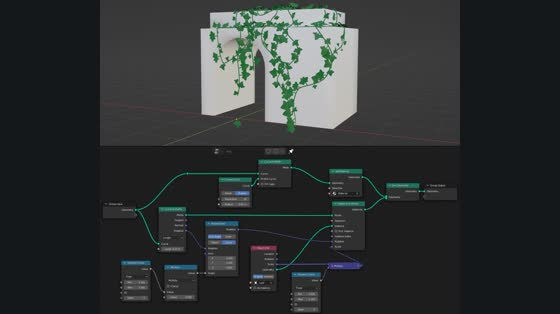
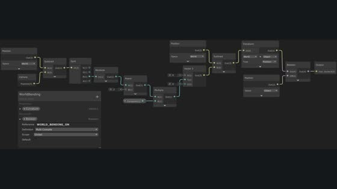
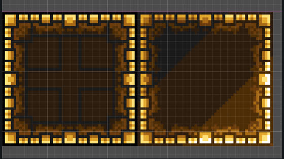

# Awesome Game Art Styles 

  

[English](README.md) · **简体中文**

> 64 种游戏视觉风格，按**观感**分类。点进每种风格可以看截图、识别要点、实现技术、教程、免费素材，以及给编程智能体的实现步骤。

🌐 **中文网页版：[homkathon.gokoding.com/styles](https://homkathon.gokoding.com/styles)**。可以搜索、按分类筛选，在每种风格的页面里翻截图、直接玩在线演示。

截图直接从 Steam 加载并链接到游戏商店页，本仓库不转存任何截图。用 [Claude Code 技能](skills/game-art-style/SKILL.md)可以为你的游戏推荐风格（安装方法：让你的编程智能体读 [https://homkathon.gokoding.com/styles/install.md](https://homkathon.gokoding.com/styles/install.md)），也可以打开[在线着色器演示](https://homkathon.github.io/awesome-game-art-styles/demos/)看卡通、PS1、1-bit 和像素化 3D 的实时效果。在 [X 视频画廊](https://homkathon.github.io/awesome-game-art-styles/x-posts/)直接播放或下载经授权收录的 MP4（保留作者及原帖链接）。风格详情页目前为英文。

## 目录

- [3D：明暗与造型](#3d明暗与造型)
- [3D：复古与低保真](#3d复古与低保真)
- [3D：手作与材质](#3d手作与材质)
- [光与剪影](#光与剪影)
- [2D：像素](#2d像素)
- [2D：手绘与绘画](#2d手绘与绘画)
- [2D：平面与印刷](#2d平面与印刷)
- [素材库](#素材库)
- [学习资源](#学习资源)

- [插画游戏灵感](#illustrated-inspiration)

## 插画游戏灵感 · 16 款作品

以下都是独立的视觉案例，不是 16 种人为拆分出来的美术流派。点击图片查看 Steam 原始截图和游戏，点击风格进入实现说明。

<table>
<tr>
<td width="50%" valign="top"> <b><a href="https://store.steampowered.com/app/1172450/">Carto</a></b> <a href="styles/gouache-picture-book/">水粉质感绘本</a> 手绘地图图块与讨喜小人物</td>
<td width="50%" valign="top"> <b><a href="https://store.steampowered.com/app/3256150/">Moomintroll: Winter's Warmth</a></b> <a href="styles/nordic-watercolour-woodland/">北欧水彩森林</a> 雪景纸纹与北欧森林</td>
</tr>
<tr>
<td width="50%" valign="top"> <b><a href="https://store.steampowered.com/app/1808680/">Snufkin: Melody of Moominvalley</a></b> <a href="styles/nordic-watercolour-woodland/">北欧水彩森林</a> 宁静的水彩林地探索</td>
<td width="50%" valign="top"> <b><a href="https://store.steampowered.com/app/1307580/">TOEM: A Photo Adventure</a></b> <a href="styles/whimsical-ink/">俏皮黑白手绘</a> 黑白墨线剪纸与柔和 3D 景深</td>
</tr>
<tr>
<td width="50%" valign="top"> <b><a href="https://store.steampowered.com/app/1419860/">Tukoni: Prologue</a></b> <a href="styles/woodland-folklore-illustration/">森林民间传说插画</a> 手绘森林生灵与植物</td>
<td width="50%" valign="top"> <b><a href="https://store.steampowered.com/app/1444300/">Teacup</a></b> <a href="styles/pastel-creature-vignettes/">柔色小生灵插画</a> 柔色动物绘本场景</td>
</tr>
<tr>
<td width="50%" valign="top"> <b><a href="https://store.steampowered.com/app/1055540/">A Short Hike</a></b> <a href="styles/cozy-lowres-nature-3d/">低分辨率自然微缩景</a> 像素柔化的户外探索</td>
<td width="50%" valign="top"> <b><a href="https://store.steampowered.com/app/1594940/">Little Witch in the Woods</a></b> <a href="styles/cozy-pixel-storybook/">温暖绘本像素</a> 温暖而细致的森林像素</td>
</tr>
<tr>
<td width="50%" valign="top"> <b><a href="https://store.steampowered.com/app/1123450/">Chicory: A Colorful Tale</a></b> <a href="styles/loose-line-cartoons/">松弛线稿卡通</a> 松弛墨线与趣味填色</td>
<td width="50%" valign="top"> <b><a href="https://store.steampowered.com/app/977880/">Eastward</a></b> <a href="styles/cinematic-pixel-painting/">电影感像素绘景</a> 细致的电影感像素绘景</td>
</tr>
<tr>
<td width="50%" valign="top"> <b><a href="https://store.steampowered.com/app/1062140/">Garden Story</a></b> <a href="styles/cozy-pixel-storybook/">温暖绘本像素</a> 圆润的像素小生灵</td>
<td width="50%" valign="top"> <b><a href="https://store.steampowered.com/app/729000/">Wytchwood</a></b> <a href="styles/woodland-folklore-illustration/">森林民间传说插画</a> 装饰性的民俗森林</td>
</tr>
<tr>
<td width="50%" valign="top"> <b><a href="https://store.steampowered.com/app/581270/">Old Man's Journey</a></b> <a href="styles/layered-paper-landscapes/">分层纸片风景</a> 层叠的手绘纸片风景</td>
<td width="50%" valign="top"> <b><a href="https://store.steampowered.com/app/2322180/">A Tiny Sticker Tale</a></b> <a href="styles/stickerbook-cutouts/">贴纸绘本拼贴</a> 可摆弄的贴纸式绘本道具</td>
</tr>
<tr>
<td width="50%" valign="top"> <b><a href="https://store.steampowered.com/app/1889740/">Paper Trail</a></b> <a href="styles/illustrated-paper-puzzles/">纸面插画解谜</a> 可折叠的插画纸面世界</td>
<td width="50%" valign="top"> <b><a href="https://store.steampowered.com/app/435400/">Hidden Folks</a></b> <a href="styles/whimsical-ink/">俏皮黑白手绘</a> 微型黑白涂鸦场景</td>
</tr>
</table>

### 插画创作者参考

作者作品仅供研究参考，不代表可自由复用的素材。

- [Oksana Bula](https://www.tukoni.com.ua/en) — Tukoni 绘本创作者
- [Tove Jansson](https://tovejansson.com/gallery/the-moomins/) — 姆明原作及插画创作者
- [Kuan-Hung Chen](https://sunheadgames.com/en/press/carto/) — Carto 美术参考
- [Sylvain Tegroeg](https://vgagallery.org/collection/sylvain-tegroeg-factory) — Hidden Folks 黑白墨线画
- [Carson Ellis](https://www.carsonellis.com/work-gallery/) — 奇趣的绘本风景
- [Rebecca Green](https://www.myblankpaper.com/work/) — 粉彩、铅笔与水粉插画

---

## 3D：明暗与造型

<table>
<tr>
<td align="center" valign="top" width="25%"> <a href="styles/low-poly/"><b>低多边形</b></a> Low-poly</td>
<td align="center" valign="top" width="25%"> <a href="styles/toy-diorama/"><b>玩具微缩景</b></a> Toy diorama / tilt-shift</td>
<td align="center" valign="top" width="25%"> <a href="styles/minimal-geometric/"><b>极简几何 3D</b></a> Minimal geometric 3D</td>
<td align="center" valign="top" width="25%"> <a href="styles/toon/"><b>卡通渲染</b></a> Cel-shaded / toon</td>
</tr>
<tr>
<td align="center" valign="top" width="25%"> <a href="styles/anime-cel/"><b>日式赛璐璐 2.5D</b></a> Anime cel 2.5D</td>
<td align="center" valign="top" width="25%"> <a href="styles/ligne-claire/"><b>清线 / 墨比斯</b></a> Ligne claire / Moebius</td>
<td align="center" valign="top" width="25%"> <a href="styles/painterly/"><b>油画感</b></a> Painterly</td>
<td align="center" valign="top" width="25%"> <a href="styles/flat-colour-3d/"><b>平涂图形化 3D</b></a> Flat-colour graphic 3D</td>
</tr>
<tr>
<td align="center" valign="top" width="25%"> <a href="styles/retro-futurism/"><b>复古未来主义</b></a> Retro-futurism</td>
<td align="center" valign="top" width="25%"> <a href="styles/mixed-media/"><b>混合媒介</b></a> Mixed media</td>
<td align="center" valign="top" width="25%"> <a href="styles/fmv/"><b>真人影像 / FMV</b></a> FMV / live action</td>
<td align="center" valign="top" width="25%"> <a href="styles/graffiti/"><b>涂鸦 / Y2K 街头</b></a> Graffiti / Y2K street</td>
</tr>
<tr>
<td align="center" valign="top" width="25%"> <a href="styles/soft-pastel/"><b>软萌糖果色</b></a> Soft pastel / jelly</td>
</tr>
</table>

## 3D：复古与低保真

<table>
<tr>
<td align="center" valign="top" width="25%"> <a href="styles/ps1/"><b>PS1 复古 3D</b></a> PS1 / low-fi 3D</td>
<td align="center" valign="top" width="25%"> <a href="styles/pixelated-3d/"><b>像素化 3D</b></a> Pixelated 3D</td>
<td align="center" valign="top" width="25%"> <a href="styles/voxel/"><b>体素</b></a> Voxel</td>
<td align="center" valign="top" width="25%"> <a href="styles/1-bit/"><b>1-bit 抖动</b></a> 1-bit / dithered</td>
</tr>
<tr>
<td align="center" valign="top" width="25%"> <a href="styles/pre-rendered/"><b>预渲染背景</b></a> Pre-rendered backgrounds</td>
<td align="center" valign="top" width="25%"> <a href="styles/boomer-shooter/"><b>复古 FPS</b></a> Retro FPS / boomer shooter</td>
<td align="center" valign="top" width="25%"> <a href="styles/lo-fi-surreal/"><b>低保真超现实 / 丑美学</b></a> Lo-fi surreal / ugly</td>
<td align="center" valign="top" width="25%"> <a href="styles/cozy-lowres-nature-3d/"><b>低分辨率自然微缩景</b></a> Cozy low-resolution 3D nature</td>
</tr>
</table>

## 3D：手作与材质

<table>
<tr>
<td align="center" valign="top" width="25%"> <a href="styles/claymation/"><b>黏土定格</b></a> Claymation</td>
<td align="center" valign="top" width="25%"> <a href="styles/papercraft/"><b>纸艺</b></a> Papercraft</td>
<td align="center" valign="top" width="25%"> <a href="styles/yarn/"><b>毛线 / 织物</b></a> Yarn / fabric</td>
<td align="center" valign="top" width="25%"> <a href="styles/dark-miniature/"><b>黑暗微缩</b></a> Dark miniature</td>
</tr>
</table>

## 光与剪影

<table>
<tr>
<td align="center" valign="top" width="25%"> <a href="styles/silhouette/"><b>剪影黑白</b></a> Silhouette noir</td>
<td align="center" valign="top" width="25%"> <a href="styles/neon-abstract/"><b>霓虹抽象</b></a> Neon abstract</td>
<td align="center" valign="top" width="25%"> <a href="styles/vector-wireframe/"><b>矢量线框</b></a> Vector / wireframe</td>
<td align="center" valign="top" width="25%"> <a href="styles/spot-colour/"><b>单色 + 强调色</b></a> Monochrome + one colour</td>
</tr>
<tr>
<td align="center" valign="top" width="25%"> <a href="styles/liminal/"><b>阈限空间</b></a> Liminal spaces</td>
</tr>
</table>

## 2D：像素

<table>
<tr>
<td align="center" valign="top" width="25%"> <a href="styles/pixel-art/"><b>像素画</b></a> Pixel art</td>
<td align="center" valign="top" width="25%"> <a href="styles/hd-2d/"><b>HD-2D</b></a> HD-2D</td>
<td align="center" valign="top" width="25%"> <a href="styles/pixel-anime/"><b>像素动漫 / 赛博朋克</b></a> Pixel anime / cyberpunk</td>
<td align="center" valign="top" width="25%"> <a href="styles/neon-80s/"><b>80 年代霓虹像素</b></a> Neon 80s pixel</td>
</tr>
<tr>
<td align="center" valign="top" width="25%"> <a href="styles/cozy/"><b>温馨室内像素</b></a> Cozy interiors</td>
<td align="center" valign="top" width="25%"> <a href="styles/nes-8bit/"><b>8-bit / FC</b></a> 8-bit / NES</td>
<td align="center" valign="top" width="25%"> <a href="styles/cozy-pixel-storybook/"><b>温暖绘本像素</b></a> Cozy storybook pixel art</td>
<td align="center" valign="top" width="25%"> <a href="styles/cinematic-pixel-painting/"><b>电影感像素绘景</b></a> Cinematic pixel painting</td>
</tr>
</table>

## 2D：手绘与绘画

<table>
<tr>
<td align="center" valign="top" width="25%"> <a href="styles/hand-drawn/"><b>手绘动画</b></a> Hand-drawn animation</td>
<td align="center" valign="top" width="25%"> <a href="styles/rubber-hose/"><b>橡皮管 30 年代卡通</b></a> Rubber hose (1930s cartoon)</td>
<td align="center" valign="top" width="25%"> <a href="styles/watercolour/"><b>水彩</b></a> Watercolour</td>
<td align="center" valign="top" width="25%"> <a href="styles/ink-wash/"><b>水墨</b></a> Ink wash / sumi-e</td>
</tr>
<tr>
<td align="center" valign="top" width="25%"> <a href="styles/gothic-ink/"><b>哥特墨线</b></a> Gothic ink</td>
<td align="center" valign="top" width="25%"> <a href="styles/painted-comic/"><b>彩绘漫画</b></a> Painted comic</td>
<td align="center" valign="top" width="25%"> <a href="styles/line-art/"><b>线稿 / 涂色书</b></a> Line art / colouring book</td>
<td align="center" valign="top" width="25%"> <a href="styles/cute-dark/"><b>可爱黑暗</b></a> Cute but dark</td>
</tr>
<tr>
<td align="center" valign="top" width="25%"> <a href="styles/storybook/"><b>绘本</b></a> Storybook / picture book</td>
<td align="center" valign="top" width="25%"> <a href="styles/rotoscope/"><b>转描 / 平面多边形</b></a> Rotoscope / flat polygons</td>
<td align="center" valign="top" width="25%"> <a href="styles/gouache-picture-book/"><b>水粉质感绘本</b></a> Gouache picture book</td>
<td align="center" valign="top" width="25%"> <a href="styles/whimsical-ink/"><b>俏皮黑白手绘</b></a> Whimsical monochrome ink</td>
</tr>
<tr>
<td align="center" valign="top" width="25%"> <a href="styles/nordic-watercolour-woodland/"><b>北欧水彩森林</b></a> Nordic watercolour woodland</td>
<td align="center" valign="top" width="25%"> <a href="styles/layered-paper-landscapes/"><b>分层纸片风景</b></a> Layered paper landscapes</td>
<td align="center" valign="top" width="25%"> <a href="styles/stickerbook-cutouts/"><b>贴纸绘本拼贴</b></a> Stickerbook cutouts</td>
<td align="center" valign="top" width="25%"> <a href="styles/woodland-folklore-illustration/"><b>森林民间传说插画</b></a> Woodland folklore illustration</td>
</tr>
<tr>
<td align="center" valign="top" width="25%"> <a href="styles/loose-line-cartoons/"><b>松弛线稿卡通</b></a> Loose-line storybook cartoons</td>
<td align="center" valign="top" width="25%"> <a href="styles/pastel-creature-vignettes/"><b>柔色小生灵插画</b></a> Pastel creature vignettes</td>
</tr>
</table>

## 2D：平面与印刷

<table>
<tr>
<td align="center" valign="top" width="25%"> <a href="styles/flat-vector/"><b>扁平极简矢量</b></a> Flat vector minimal</td>
<td align="center" valign="top" width="25%"> <a href="styles/graphic-design/"><b>平面设计</b></a> Graphic design / Saul Bass</td>
<td align="center" valign="top" width="25%"> <a href="styles/bureaucratic/"><b>官僚 / 宣传画</b></a> Bureaucratic / propaganda</td>
<td align="center" valign="top" width="25%"> <a href="styles/manuscript/"><b>中世纪手抄本 / 木刻</b></a> Medieval manuscript / woodcut</td>
</tr>
<tr>
<td align="center" valign="top" width="25%"> <a href="styles/ascii/"><b>ASCII / 字符画</b></a> ASCII / text</td>
<td align="center" valign="top" width="25%"> <a href="styles/desktop-ui/"><b>桌面 / 操作系统界面</b></a> Desktop / OS interface</td>
<td align="center" valign="top" width="25%"> <a href="styles/stained-glass/"><b>彩色玻璃</b></a> Stained glass</td>
<td align="center" valign="top" width="25%"> <a href="styles/illustrated-paper-puzzles/"><b>纸面插画解谜</b></a> Illustrated paper puzzles</td>
</tr>
</table>

## 素材库

授权说明于 2026-10-28 核对。授权会变，发布前请到素材页面再确认。🟢 CC0 · 🟡 CC-BY · 🟠 自定义 / 不明确 · 🔴 商业授权

| 素材库 | 类型 | 授权 | 费用 | 说明 |
|---|---|---|---|---|
| [KayKit Furniture Bits](https://kaylousberg.itch.io/furniture-bits) | 3D | 🟢 CC0 | 免费 | 50 多件家具共用一张渐变贴图：改一张图就能给整套换色。作者希望不要原样转售素材，授权仍为 CC0。[GitHub](https://github.com/KayKit-Game-Assets/KayKit-Furniture-Bits-1.0) 上有 Godot 插件版，以及其他 [KayKit 素材包](https://github.com/KayKit-Game-Assets)。 |
| [Kenney](https://kenney.nl/assets) | 3D / 2D | 🟢 CC0 | 免费 | 素材量巨大，包括带动画的 [Mini Characters](https://kenney.nl/assets/mini-characters) 和 [Furniture Kit](https://kenney.nl/assets/furniture-kit)。 |
| [Quaternius](https://quaternius.itch.io) | 3D | 🟠 自定义 | 免费 | 素材页写的是 CC0，但网站现在发布了自己的 Quaternius Asset Licence。 |
| [Poly Pizza](https://poly.pizza) | 3D | 🟡 CC0 / CC-BY | 免费 | 7000 多个低多边形模型；每个都要单独看授权。 |
| [Synty POLYGON](https://syntystore.com/products/polygon-office-pack) | 3D | 🔴 商业 | 付费 | 大型主题素材包；授权条款没有提到网页版。 |
| [LimeZu Modern Interiors](https://limezu.itch.io/moderninteriors) | 像素 | 🔴 商业 | 付费 | 需要署名。温馨像素室内。 |
| [2dPig Pixel Office](https://2dpig.itch.io/pixel-office) | 像素 | 🟢 CC0 | 免费 | 办公室道具和五个角色。 |
| [Open Peeps](https://www.openpeeps.com) | 2D | 🟢 CC0 | 免费 | 手绘风格、可自由拼装的人物。 |
| [Humaaans](https://www.humaaans.com) | 2D | 🟠 不明确 | 免费 | 不同来源的授权说法不一致。 |
| [ambientCG](https://ambientcg.com) | 贴图 | 🟢 CC0 | 免费 | 纸、布料、木头。[官方授权说明](https://docs.ambientcg.com/license/)确认可商用且无需署名。 |
| [Poly Haven](https://polyhaven.com) | 贴图 / HDRI | 🟢 CC0 | 免费 | HDRI、贴图、模型。 |

## 学习资源

| 资源 | 形式 | 内容 |
|---|---|---|
| [Godot Shaders](https://godotshaders.com) | 着色器库 | 卡通、描边、PSX、抖动、水彩等。 |
| [Toon shader tutorial](https://roystan.net/articles/toon-shader/) | 文章 | 一步步实现卡通着色（Roystan）。 |
| [5 ways to draw an outline](https://ameye.dev/notes/rendering-outlines/) | 文章 | 各种描边技术的对比（Alexander Ameye）。 |
| [GuiltyGearXrd's Art Style](https://www.youtube.com/watch?v=yhGjCzxJV3E) | GDC 演讲 | 让 3D 看起来像手绘。 |
| [Obra Dinn devlog: dithering](https://forums.tigsource.com/index.php?topic=40832.msg1363742#msg1363742) | 开发日志 | 稳定的 1-bit 抖动（Lucas Pope）。 |
| [Acerola](https://www.youtube.com/@Acerola_t) | 视频频道 | 风格化渲染深度解析。 |
| [t3ssel8r](https://www.youtube.com/@t3ssel8r) | 视频频道 | 实时 3D 中的像素画观感。 |
| [Lospec palette list](https://lospec.com/palette-list) | 调色板库 | 像素画和限色风格的调色板。 |

## X 热门技术帖精选

直接在这里用 GitHub 原生播放器观看视频；没有视频的原帖展示图片。

[在 X 视频画廊播放和下载经授权的 MP4](https://homkathon.github.io/awesome-game-art-styles/x-posts/)（保留作者、原文与原帖链接；无视频帖使用 X 嵌入）。

共 22 条已核实的创作者原帖，按具体技法分组。优先收录可参考的 Shader、渲染和美术制作方法，不按未经验证的互动数字排序。**人工精选，并非实时热榜**。作者、原帖内容和发布日期于 2026-10-28 通过 X 嵌入元数据核实。

### 水体与氛围

<table>
<tr>
<td width="50%" valign="top">
<video src="https://github.com/user-attachments/assets/e66f2271-3549-4186-8cfc-7d937077a227" controls width="100%" playsinline></video>

<strong><a href="https://homkathon.github.io/awesome-game-art-styles/x-posts/#post-1864638156588400707">海岸线 Shader 新版</a></strong>

视频 · @Cyanilux · 2024-12-05 · <a href="https://x.com/Cyanilux/status/1864638156588400707">原帖 ↗</a>

海浪、岸边泡沫与湿沙的着色效果，原帖评论附教程

关联风格: <a href="styles/cozy/">温馨室内像素</a>
</td>
<td width="50%" valign="top">

<strong><a href="https://homkathon.github.io/awesome-game-art-styles/x-posts/#post-1252298028607774721">海岸线 Shader 原理拆解</a></strong>

图文 · @Cyanilux · 2020-04-20 · <a href="https://x.com/Cyanilux/status/1252298028607774721">原帖 ↗</a>

受《动物森友会》启发的水深感知岸边浪花与水面边缘

关联风格: <a href="styles/cozy/">温馨室内像素</a>
</td>
</tr>
<tr>
<td width="50%" valign="top">
<video src="https://github.com/user-attachments/assets/86cbd001-062d-4224-a2fd-205b6ddd832e" controls width="100%" playsinline></video>

<strong><a href="https://homkathon.github.io/awesome-game-art-styles/x-posts/#post-1581210772352290818">Gerstner 波浪海面</a></strong>

视频 · @Cyanilux · 2022-10-15 · <a href="https://x.com/Cyanilux/status/1581210772352290818">原帖 ↗</a>

用 Gerstner 波叠加位移塑造风格化海面

关联风格: <a href="styles/flat-colour-3d/">平涂图形化 3D</a>
</td>
<td width="50%" valign="top">
<video src="https://github.com/user-attachments/assets/53a5d7c2-abba-45e7-b21a-168670d6f39a" controls width="100%" playsinline></video>

<strong><a href="https://homkathon.github.io/awesome-game-art-styles/x-posts/#post-1770095395848237506">2.5D 水面与精灵反射</a></strong>

视频 · @Cyanilux · 2024-03-19 · <a href="https://x.com/Cyanilux/status/1770095395848237506">原帖 ↗</a>

俯视水体 Shader 与像素精灵倒影

关联风格: <a href="styles/hd-2d/">HD-2D</a>
</td>
</tr>
<tr>
<td width="50%" valign="top">
<video src="https://github.com/user-attachments/assets/224bc590-5f2b-416a-854e-5efbb4abf0c8" controls width="100%" playsinline></video>

<strong><a href="https://homkathon.github.io/awesome-game-art-styles/x-posts/#post-1495405379253116930">程序化极光</a></strong>

视频 · @Cyanilux · 2022-02-20 · <a href="https://x.com/Cyanilux/status/1495405379253116930">原帖 ↗</a>

细分面片位移、渐变、滚动噪声与远处淡出

关联风格: <a href="styles/neon-abstract/">霓虹抽象</a>
</td>
</tr>
</table>

### 光照与风格化渲染

<table>
<tr>
<td width="50%" valign="top">

<strong><a href="https://homkathon.github.io/awesome-game-art-styles/x-posts/#post-1975506073319567393">解析式环境光遮蔽</a></strong>

图文 · @florisium · 2025-10-07 · <a href="https://x.com/florisium/status/1975506073319567393">原帖 ↗</a>

基于几何体的解析式 AO 技术及场景前后对比（技术长帖）

关联风格: <a href="styles/toy-diorama/">玩具微缩景</a>
</td>
<td width="50%" valign="top">
<video src="https://github.com/user-attachments/assets/b8802851-7f05-42ab-bcd7-d29ecaf630ee" controls width="100%" playsinline></video>

<strong><a href="https://homkathon.github.io/awesome-game-art-styles/x-posts/#post-1783442615939297380">面片假体积光</a></strong>

视频 · @Cyanilux · 2024-04-25 · <a href="https://x.com/Cyanilux/status/1783442615939297380">原帖 ↗</a>

沿光方向拉伸面片、阴影遮罩与深度淡出

关联风格: <a href="styles/silhouette/">剪影黑白</a>
</td>
</tr>
<tr>
<td width="50%" valign="top">
<video src="https://github.com/user-attachments/assets/0e7f9450-9a62-4189-91c0-f0b19ca44dce" controls width="100%" playsinline></video>

<strong><a href="https://homkathon.github.io/awesome-game-art-styles/x-posts/#post-1362466015976783872">《辛特堡传说》描边拆解</a></strong>

视频 · @PhilippSeifried · 2021-02-18 · <a href="https://x.com/PhilippSeifried/status/1362466015976783872">原帖 ↗</a>

技术长帖：如何控制风格化描边的宽度和位置

关联风格: <a href="styles/ligne-claire/">清线 / 墨比斯</a>
</td>
<td width="50%" valign="top">
<video src="https://github.com/user-attachments/assets/07fc6d86-883e-4cd8-9951-4bdce6d60d5f" controls width="100%" playsinline></video>

<strong><a href="https://homkathon.github.io/awesome-game-art-styles/x-posts/#post-1354827696707002384">《辛特堡传说》风格化渲染</a></strong>

视频 · @PhilippSeifried · 2021-01-28 · <a href="https://x.com/PhilippSeifried/status/1354827696707002384">原帖 ↗</a>

自定义延迟渲染，利用 G-buffer 中的材质 ID 控制风格

关联风格: <a href="styles/toon/">卡通渲染</a>
</td>
</tr>
</table>

### 材质与程序化场景

<table>
<tr>
<td width="50%" valign="top">
<video src="https://github.com/user-attachments/assets/86c7023c-eec3-483d-99cf-33140ed14cfa" controls width="100%" playsinline></video>

<strong><a href="https://homkathon.github.io/awesome-game-art-styles/x-posts/#post-1407727586986311687">彩色玻璃与体积光</a></strong>

视频 · @Cyanilux · 2021-06-23 · <a href="https://x.com/Cyanilux/status/1407727586986311687">原帖 ↗</a>

玻璃片分区着色与 Ray Marching 光束结合

关联风格: <a href="styles/stained-glass/">彩色玻璃</a>
</td>
<td width="50%" valign="top">
<video src="https://github.com/user-attachments/assets/08022f98-f2e1-4633-bb78-b5b22675ff32" controls width="100%" playsinline></video>

<strong><a href="https://homkathon.github.io/awesome-game-art-styles/x-posts/#post-1376949139838275584">镭射烫金材质</a></strong>

视频 · @Cyanilux · 2021-03-30 · <a href="https://x.com/Cyanilux/status/1376949139838275584">原帖 ↗</a>

彩虹贴图配合切线空间视线方向 UV 视差

关联风格: <a href="styles/retro-futurism/">复古未来主义</a>
</td>
</tr>
<tr>
<td width="50%" valign="top">
<video src="https://github.com/user-attachments/assets/c8370dfa-6f0a-43ab-9a1b-159b0c1e017b" controls width="100%" playsinline></video>

<strong><a href="https://homkathon.github.io/awesome-game-art-styles/x-posts/#post-1396848736022802435">Shader Graph GPU 草地</a></strong>

视频 · @Cyanilux · 2021-05-24 · <a href="https://x.com/Cyanilux/status/1396848736022802435">原帖 ↗</a>

Unity Shader Graph 配合 DrawMeshInstancedIndirect 草地实例化

关联风格: <a href="styles/low-poly/">低多边形</a>
</td>
<td width="50%" valign="top">

<strong><a href="https://homkathon.github.io/awesome-game-art-styles/x-posts/#post-1618030887412862977">沿曲线生长的常春藤</a></strong>

图文 · @Cyanilux · 2023-01-24 · <a href="https://x.com/Cyanilux/status/1618030887412862977">原帖 ↗</a>

用 Blender Geometry Nodes 沿手绘曲线布置藤叶

关联风格: <a href="styles/low-poly/">低多边形</a>
</td>
</tr>
<tr>
<td width="50%" valign="top">

<strong><a href="https://homkathon.github.io/awesome-game-art-styles/x-posts/#post-1251916279205814272">世界弯曲 Shader Graph</a></strong>

图文 · @Cyanilux · 2020-04-19 · <a href="https://x.com/Cyanilux/status/1251916279205814272">原帖 ↗</a>

Shader Graph 弯曲子图，并通过 C# 关键字控制运行时启用

关联风格: <a href="styles/toy-diorama/">玩具微缩景</a>
</td>
</tr>
</table>

### 特效与破碎

<table>
<tr>
<td width="50%" valign="top">
<video src="https://github.com/user-attachments/assets/ab573f7f-a2d8-4524-ac25-3050c654ef38" controls width="100%" playsinline></video>

<strong><a href="https://homkathon.github.io/awesome-game-art-styles/x-posts/#post-2019471084375130140">假体积烟雾</a></strong>

视频 · @Tuatara_Games · 2026-02-05 · <a href="https://x.com/Tuatara_Games/status/2019471084375130140">原帖 ↗</a>

面向镜头的形变网格、无光照材质与法线贴图假方向光

关联风格: <a href="styles/silhouette/">剪影黑白</a>
</td>
<td width="50%" valign="top">
<video src="https://github.com/user-attachments/assets/d63c4858-075a-4601-8827-ce15b0d12efe" controls width="100%" playsinline></video>

<strong><a href="https://homkathon.github.io/awesome-game-art-styles/x-posts/#post-1483094258076856320">噪声层构成的龙卷风</a></strong>

视频 · @Cyanilux · 2022-01-17 · <a href="https://x.com/Cyanilux/status/1483094258076856320">原帖 ↗</a>

Alpha 裁剪的滚动噪声叠层、顶点位移与粒子尾迹

关联风格: <a href="styles/silhouette/">剪影黑白</a>
</td>
</tr>
<tr>
<td width="50%" valign="top">
<video src="https://github.com/user-attachments/assets/cb1ccdff-b7eb-418b-be98-f76d9b4e407a" controls width="100%" playsinline></video>

<strong><a href="https://homkathon.github.io/awesome-game-art-styles/x-posts/#post-1638623920235356172">RenderTexture 驱动破碎</a></strong>

视频 · @Cyanilux · 2023-03-22 · <a href="https://x.com/Cyanilux/status/1638623920235356172">原帖 ↗</a>

用 Graphics.Blit 将射线命中位置写入遮罩，驱动表面破碎

关联风格: <a href="styles/boomer-shooter/">复古 FPS</a>
</td>
<td width="50%" valign="top">
<video src="https://github.com/user-attachments/assets/a42790d7-ef63-4e9d-9c34-1624e0318f3a" controls width="100%" playsinline></video>

<strong><a href="https://homkathon.github.io/awesome-game-art-styles/x-posts/#post-1524697139812573185">顶点位移触手</a></strong>

视频 · @Cyanilux · 2022-05-12 · <a href="https://x.com/Cyanilux/status/1524697139812573185">原帖 ↗</a>

用顶点位移驱动程序化触手形变

关联风格: <a href="styles/lo-fi-surreal/">低保真超现实 / 丑美学</a>
</td>
</tr>
<tr>
<td width="50%" valign="top">
<video src="https://github.com/user-attachments/assets/4acc81d1-e91a-4ecf-91ae-bcc50e2597d7" controls width="100%" playsinline></video>

<strong><a href="https://homkathon.github.io/awesome-game-art-styles/x-posts/#post-1467533351091376136">魔法斩击特效</a></strong>

视频 · @Cyanilux · 2021-12-05 · <a href="https://x.com/Cyanilux/status/1467533351091376136">原帖 ↗</a>

Shader 驱动的斩击特效，作者另有 Shader Graph 拆解

关联风格: <a href="styles/anime-cel/">日式赛璐璐 2.5D</a>
</td>
</tr>
</table>

### 像素与 2D

<table>
<tr>
<td width="50%" valign="top">
<video src="https://github.com/user-attachments/assets/a26ff1b1-d8ed-4b82-a883-2bc1be40bce7" controls width="100%" playsinline></video>

<strong><a href="https://homkathon.github.io/awesome-game-art-styles/x-posts/#post-1068933280005844992">像素瀑布拆解</a></strong>

视频 · @lunoland · 2018-12-01 · <a href="https://x.com/lunoland/status/1068933280005844992">原帖 ↗</a>

精灵图、Shader 与 13 组粒子系统叠加的像素瀑布

关联风格: <a href="styles/pixel-art/">像素画</a>
</td>
<td width="50%" valign="top">
<video src="https://github.com/user-attachments/assets/4a23baa7-ce56-433c-b969-b6d528a4736b" controls width="100%" playsinline></video>

<strong><a href="https://homkathon.github.io/awesome-game-art-styles/x-posts/#post-1595484469699526665">抖动与像素化光照</a></strong>

视频 · @Cyanilux · 2022-11-23 · <a href="https://x.com/Cyanilux/status/1595484469699526665">原帖 ↗</a>

把光照分解为像素块与抖动网点的实验

关联风格: <a href="styles/pixelated-3d/">像素化 3D</a>
</td>
</tr>
<tr>
<td width="50%" valign="top">

<strong><a href="https://homkathon.github.io/awesome-game-art-styles/x-posts/#post-1847072515572507001">调色板驱动的像素光照</a></strong>

图文 · @MadeInHevinis · 2024-10-18 · <a href="https://x.com/MadeInHevinis/status/1847072515572507001">原帖 ↗</a>

直接从精灵明暗调色板映射光照颜色

关联风格: <a href="styles/pixel-art/">像素画</a>
</td>
</tr>
</table>

---

如果这份列表帮你选定了画风，点个 ⭐ 能让更多开发者看到它。
